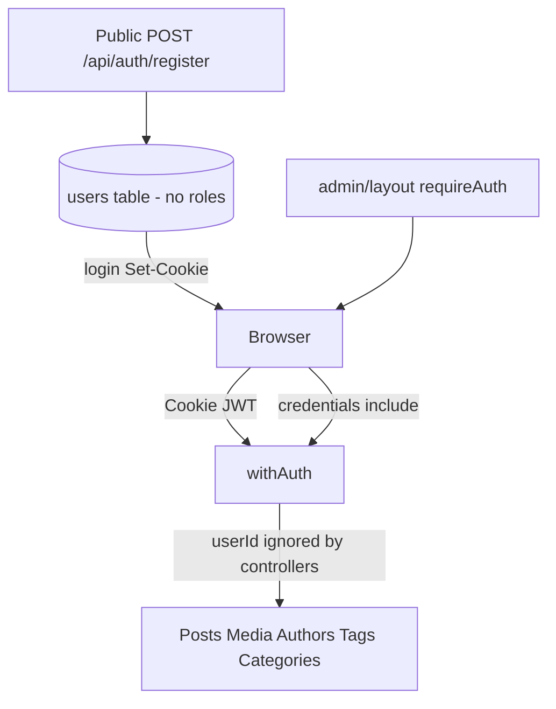

# Codebase Audit Report — Author AI Assistant Dashboard

**Date:** 2026-10-15  
**Scope:** Static review of this repository (Next.js 16 + React 19 + PostgreSQL + RTK Query + Cloudinary).  
**Method:** Architecture / security / domain-logic / frontend review. No automated suite was executed (none exists in-repo).  
**Skills applied (conceptually):** code-review, security-and-hardening, debugging-strategies, planning-and-task-breakdown.

---

## 1. Executive summary

| | |
|--|--|
| **Overall grade** | **C / 5.2 out of 10** |
| **Verdict** | Solid layered structure for an early private CMS prototype. **Not production-safe** for any public deployment until registration is gated and authorization (roles) exists. |
| **Highest risk** | Open self-service registration + every authenticated user has full CMS CRUD (no roles, `userId` unused). |
| **Tests** | Unit suite added (`npm test`) for policies, authz middleware, pagination, secure compare, public register gate. |

### Scorecard

| Area | Score | Verdict |
|------|-------|---------|
| Architecture & layering | 7.5/10 | Clean route → controller → service → repository; appropriate for this size |
| Security & authz | 3.0/10 | Cookie/JWT patterns are decent; open register + no RBAC is fatal for public deploy |
| Backend domain logic | 6.0/10 | Post transactions solid; tags / media delete / delete guards have real bugs |
| API / routes design | 6.0/10 | Consistent CRUD + `withAuth`; REST inconsistencies; no public read API |
| Frontend quality | 6.0/10 | Feature folders + RTK tags good; several logic/UX bugs |
| Validation | 6.5/10 | Yup server-side with `stripUnknown`; client gaps and dead schemas |
| Testing | 1.0/10 | No automated tests; docs mention smoke tests but none ship in repo |
| Docs / ops | 5.0/10 | `AUTHENTICATION.md` / `CATEGORY-MODULE.md` referenced; README still create-next-app boilerplate |

---

## 2. Stack & architecture snapshot

**Stack:** Next.js App Router API routes, React admin UI, PostgreSQL via `pg`, Yup validators, bcrypt + JWT in HttpOnly cookies, Cloudinary storage adapter.

**Layers:**

| Layer | Location | Role |
|--------|----------|------|
| API routes | `src/app/api/**/route.js` | HTTP verbs; most wrapped in `withAuth` |
| Controllers | `src/backend/controllers/*.controller.js` | Parse request, validate, map `Response.json` |
| Services | `src/backend/services/*.service.js` | Business rules, transactions |
| Repositories | `src/backend/repositories/*.repository.js` | Parameterized SQL |
| Validators | `src/backend/validators/*.validator.js` | Yup schemas |
| Auth | `src/backend/middleware/auth.middleware.js`, `lib/auth-cookie.js`, `lib/require-auth.js` | Cookie JWT; admin layout SSR gate |
| Frontend | `src/frontend/feature/*` | Feature modules + RTK Query `baseApi` |
| Admin UI | `src/app/(admin)/admin/**` | Dashboard shell behind `requireAuth()` |

**Auth → CMS flow gap:** register creates a normal user → login issues a 7-day JWT → `withAuth` only checks `sub` → all CMS APIs are available. There is no role column and no per-resource ownership check.

---

## 3. Findings table

Severity: **Critical** → **High** → **Medium** → **Low**.

### Critical

| ID | Finding | Evidence | Why it matters | Suggested fix |
|----|---------|----------|----------------|---------------|
| C1 | **Open self-service registration** | `src/app/api/auth/register/route.js` exports public `POST` → `registerController`; UI at `src/app/(auth)/register/page.js` + `RegisterForm.jsx` | Anyone who can reach the app can create an account and, after login, use the full CMS | Gate with `ALLOW_REGISTRATION`, invite token, or admin-only create; remove/protect `/register` in production |
| C2 | **No authorization / roles — any logged-in user is full admin** | `001_create_users.sql` has no `role`; `withAuth` only verifies JWT `sub` (`auth.middleware.js`); `createPostController(request)` ignores `userId` (`post.controller.js`) | Combined with C1 this is full compromise of content and media | Add `role` (or admin allowlist); enforce `requireAdmin` in middleware; use `userId` for audit/ownership where needed |

### High

| ID | Finding | Evidence | Why it matters | Suggested fix |
|----|---------|----------|----------------|---------------|
| H1 | **No rate limit / lockout** on login or register | `src/app/api/auth/login/route.js`, `register/route.js` — no throttle middleware | Password spraying, credential stuffing, registration spam | IP + email keyed limits (app, edge, or reverse proxy); optional lockout |
| H2 | **Logout is cookie-clear only — no JWT revocation** | `logoutController` only `buildClearCookie()` (`auth.controller.js`); `JwtAdapter.sign` uses `expiresIn: "7d"` (`jwt.adapter.js`) | Stolen cookie/token works until expiry; password change does not invalidate sessions | Server sessions or `jti` denylist; shorter TTL + refresh rotation |
| H3 | **Resource APIs trust JWT only; `/me` alone re-checks DB** | `getUserId` / `withAuth` vs `meController` DB lookup | Deleted/disabled users keep API access up to 7 days | On each request (or cached): `findById(sub)` and reject if missing/disabled |
| H4 | **Media delete: DB removed before storage delete** | `MediaService.deleteMedia` commits `deleteWithReferencesCleared` then storage delete (`media.service.js` ~185–227); repo throws plain `Error("Media not found")` → often 500 | Orphaned Cloudinary assets; wrong HTTP status on missing media | Delete storage first (or compensating txn); map not-found to 404 |
| H5 | **Post tags resolve by display name, not slug** | `resolveTagIds` → `tagRepository.findByName(name)` (`post.service.js` ~132–146); uniqueness is on `slug` | Wrong/duplicate-tag failures; misleading “slug already exists” errors | Resolve by slug (or upsert `ON CONFLICT (slug)`); align name/slug matching |
| H6 | **Unsafe pagination offset on non-post lists** | Posts guard `(page - 1) * limit` with `Number.isSafeInteger` (`post.controller.js` ~81–88); categories/tags/authors/media only validate `page`/`limit` separately | Huge `page` can produce imprecise JS `offset` before SQL `OFFSET` | Apply the same product-safe guard everywhere |
| H7 | **Featured media remove leaves `featuredMediaId` set** | `PostEditor` `onFeaturedImageRemove` clears URL fields only (~318–324); payload still sends `featuredMediaId` (~152) | UI shows removed image; backend keeps association | Clear `featuredMediaId` (and related fields) on remove |
| H8 | **Hook import casing breaks Linux/CI** | `PostEditor.jsx` imports `.../usePostMutations`; file is `usePostmutations.js`; other files import correct casing | Case-sensitive filesystems fail the build/import | Rename file to `usePostMutations.js` and unify imports |
| H9 | **Register client validation missing; login Yup unused** | `RegisterForm.jsx` uses HTML `required` only; `login.schema.js` not wired into `LoginForm.jsx` | Poor UX; round-trip “Validation failed”; dead code | Wire Yup (or shared schemas) on both forms; match backend min password / max name |

### Medium

| ID | Finding | Evidence | Why it matters | Suggested fix |
|----|---------|----------|----------------|---------------|
| M1 | Category delete silently detaches posts (`ON DELETE SET NULL`); no post-count guard — unlike authors | `category.service.js`, migration FK on `posts.category_id` | Silent data loss of categorization | Block delete when posts exist, or require confirm + reassign |
| M2 | Tag delete cascades `post_tags` with no warning | Migration `ON DELETE CASCADE`; `TagService.deleteTag` | Silent association loss | Surface impact count; require confirm |
| M3 | Implicit tag create race under concurrency | `findByName` → `create` in post txn without upsert | Spurious 409 under load | `ON CONFLICT DO NOTHING` / upsert by slug |
| M4 | Category/tag slug check-then-insert races | Services outside a txn; unique index mitigates | Spurious 409s | Upsert or catch `23505` cleanly (posts already loop on slug) |
| M5 | `featuredMediaId` UUID-only; existence not checked | `post.validator.js`; service never loads media | FK failure mislabeled as category/author missing | Verify media row exists; fix error mapping |
| M6 | Publishing rules gaps | `validatePublishing` enforces future date only for `scheduled` | `published` + future `publishedAt` allowed; weak draft transitions | Align rules for publish/schedule/unpublish |
| M7 | REST inconsistencies | DELETE → 200 JSON; media `PATCH` vs others `PUT`; no by-slug API | Client/API ergonomics; harder public site integration | Standardize verbs/status; optional public read by slug |
| M8 | Media upload buffers large bodies in memory | `media.controller.js` up to ~105 MB buffer | DoS / memory pressure for any authenticated user | Stream upload; stricter authz; lower caps |
| M9 | Post list performance | Correlated tag subquery + `content ILIKE` in `post.repository.js` | Slow at scale | Separate tag join/aggregate; restrict search columns / FTS |
| M10 | Author `avatar_media_id` stripped by Yup | UI sets it; `author.schema.js` / `author.validator.js` omit it (`stripUnknown`) | FK unused; only URL persists | Add field to schemas end-to-end |
| M11 | Dashboard / sidebar `limit: 100` | `DashboardView.jsx` `useGetPostsQuery({ limit: 100 })`; `PostSidebar` same pattern | Wrong totals / missing picker items beyond 100 | Use `pagination.total` or dedicated stats; paginate pickers |
| M12 | Auth UX redirects incomplete | No `(auth)` “already logged in” redirect; no RTK 401 → `/` | Confusing sessions; stuck error states on admin | Auth layout redirect; `baseApi` 401 handler |
| M13 | Validation `details` ignored in UI | Backend `error-handler` returns `details`; hooks use `message` only | Users only see “Validation failed” | Map `details` to field errors / toasts |
| M14 | Preview button no-op; Header search stub | `PostEditor` disabled Preview; `Header.jsx` unused imports | Dead UI | Wire preview route or remove controls |
| M15 | Email enumeration + login timing side-channel | Register 409 `EMAIL_EXISTS`; missing user skips bcrypt | Attackers learn valid emails | Generic register response; dummy bcrypt compare |
| M16 | JWT verify without explicit algorithms; no security headers; public health | `jwt.adapter.js` `jwt.verify(token, secret)`; `next.config.mjs`; `/api/health` | Hardening / recon surface | `{ algorithms: ['HS256'] }`; CSP/frame headers; lock down health |
| M17 | Cron `timingSafeEqual` length mismatch | `cron.controller.js` | Can throw / leak secret length | Compare fixed-length HMACs then `timingSafeEqual` |

### Low / cleanup

| ID | Finding | Suggested fix |
|----|---------|---------------|
| L1 | `COOKIE_NAME = "token"` duplicated (`auth-cookie.js`, `require-auth.js`) | Single export |
| L2 | Column `password` stores bcrypt hash | Rename to `password_hash` |
| L3 | No soft deletes anywhere | Consider `deleted_at` for posts/media |
| L4 | Duplicate Yup `status` in `createPostSchema` | Remove duplicate |
| L5 | Empty search applies `ILIKE '%'` | Skip predicate when empty |
| L6 | `NewPostPage` passes props `PostEditor` ignores | Remove dead props or use them |
| L7 | Unused `getHttpUrl`, Eye icons, `passwordError` never set | Clean up |
| L8 | Mixed server/client page conventions | Standardize |
| L9 | No root `middleware.js` | Optional edge gate for `/admin` + `/api` |
| L10 | Logout does not require auth | Optional CSRF/session check |

---

## 4. What is done well

1. **Layered backend** with factories; SQL is parameterized; sort columns allowlisted; LIKE wildcards escaped.
2. **Post create/update** uses transactions; update takes row `FOR UPDATE`.
3. **Session cookie hygiene:** HttpOnly, `SameSite=Lax`, `Secure` in production; JWT not returned in login JSON body; bcrypt cost 12; register max password length respects bcrypt 72-byte limit.
4. **Frontend** sends `credentials: "include"` on `fetchBaseQuery`.
5. **Admin UI gate:** `requireAuth()` in `(admin)/admin/layout.js`; login verifies `/auth/me` before redirect.
6. **Media upload:** magic-byte validation (`file-type`), size/MIME allowlists.
7. **Cron publish:** fails closed if `CRON_SECRET` missing; uses `timingSafeEqual` (with length caveat above).
8. **Preview XSS posture:** `sanitize-post-html.js` + `PostContentRenderer` before `dangerouslySetInnerHTML` (iframe host allowlist, link `rel`, etc.).
9. **RTK Query cache tags** invalidate related lists thoughtfully (posts ↔ categories/tags/authors/media).
10. **Consistent API auth wrapping** for CMS resources under `posts`, `media`, `tags`, `categories`, `authors`.

---

## 5. Route inventory (CMS)

| Method | Path | Auth | Notes |
|--------|------|------|-------|
| POST | `/api/auth/register` | Public | **Critical** — open signup |
| POST | `/api/auth/login` | Public | Sets HttpOnly cookie |
| POST | `/api/auth/logout` | Public (clears cookie) | No revocation |
| GET | `/api/auth/me` | Cookie | Re-checks user in DB |
| GET/POST | `/api/posts`, `/api/posts/[id]` | `withAuth` | No ownership |
| GET/POST/PUT/DELETE | categories, tags, authors | `withAuth` | No ownership |
| GET/POST / PATCH/DELETE | `/api/media`, `/api/media/[id]` | `withAuth` | PATCH vs PUT elsewhere |
| GET | `/api/health` | Public | Exposes DB connectivity |
| POST | `/api/cron/publish-scheduled` | Bearer `CRON_SECRET` | Scheduled publish |

**UI routes:** `/` login, `/register`, `/admin/*` (layout-protected), preview at `/admin/post/single-post/[slug]`.

---

## 6. Prioritized remediation roadmap

### P0 — Before any public deploy

1. Gate or disable public registration (`ALLOW_REGISTRATION` / invite / remove UI + route).
2. Add admin role (or allowlist) and enforce in `withAuth` (or `requireAdmin`) on all CMS mutations and sensitive reads.
3. Stop treating every JWT holder as full admin.

### P1 — Correctness & abuse resistance

4. Rate-limit login/register.
5. Clear `featuredMediaId` on featured-media remove in `PostEditor`.
6. Rename/unify `usePostMutations` file casing.
7. Fix media delete order (storage vs DB) and 404 mapping.
8. Fix tag resolution (slug / `ON CONFLICT`) and misleading conflict errors.
9. Apply safe offset guard to all list endpoints.

### P2 — Session, UX, hardening

10. Revocable sessions or short-lived JWT + refresh; re-validate user on API calls.
11. Dashboard/sidebar: use `pagination.total` / dedicated stats; paginate pickers.
12. Map API `details` into form field errors; wire login/register Yup.
13. Auth layout: redirect logged-in users away from `/` and `/register`; RTK 401 → login.
14. Security headers in `next.config.mjs`; lock down `/api/health`; explicit JWT algorithms; fix cron compare.

### P3 — Quality & product maturity

15. Automated tests (see matrix below).
16. Soft deletes / ownership / audit fields.
17. REST consistency (DELETE 204, verb alignment, optional public by-slug read).
18. Category/tag delete guards consistent with authors.
19. Replace README boilerplate; keep module docs accurate.

---

## 7. Suggested test matrix

Given **zero** in-repo automated tests, prioritize:

| Area | Cases |
|------|--------|
| **Auth** | Register gated when disabled; login success/fail same message; cookie HttpOnly set; `/me` 401 without cookie; logout clears cookie; revoked/deleted user rejected on posts API |
| **Authz** | Non-admin cannot create/update/delete posts/media; admin can |
| **Posts** | Create draft/publish/schedule validation; tag by slug collision; featured media missing UUID → 400; pagination overflow rejected |
| **Media** | Upload reject bad MIME; delete removes storage + DB; delete missing → 404; storage failure does not leave inconsistent state |
| **Categories/tags/authors** | Delete with dependents blocked or documented; list offset safe |
| **Frontend smoke** | Login → `/admin`; featured image remove then save clears association; register validation inline errors |
| **Cron** | Wrong/missing secret → 401; valid secret publishes due scheduled posts |

Smoke docs referenced in README (`AUTHENTICATION.md`, `CATEGORY-MODULE.md`) should be turned into runnable scripts or Vitest/Playwright tests and kept in CI.

---

## 8. Evidence cross-check log

Critical/High items were re-verified against source before publishing this report:

| ID | Verified |
|----|----------|
| C1 | `register/route.js` is public `POST` with no gate |
| C2 | `001_create_users.sql` has no role; `withAuth` only checks `sub`; `createPostController` signature ignores `userId` |
| H2 | `logoutController` only clears cookie; JWT `expiresIn: "7d"` |
| H4 | `deleteMedia` deletes DB then storage |
| H5 | `resolveTagIds` uses `findByName` |
| H6 | Posts check `(page - 1) * limit` safe integer; category controller does not |
| H7 | `onFeaturedImageRemove` omits `featuredMediaId: null` |
| H8 | `PostEditor` imports `usePostMutations`; file is `usePostmutations.js` |
| Tests | Glob for `*.test` / `*.spec` returned **0** files |

---

## 9. Closing recommendation

Treat this codebase as a **private, trusted-operator CMS** until P0 is done. The architecture is a good foundation (layers, transactions on posts, cookie sessions, sanitization on preview). The dominant failure mode is **trust model**, not SQL injection or missing validation frameworks: **anyone who registers becomes an admin**, and several domain/UI bugs will corrupt or misreport content even for legitimate operators.

When you want implementation work, start with **P0 → P1** in the roadmap above.
